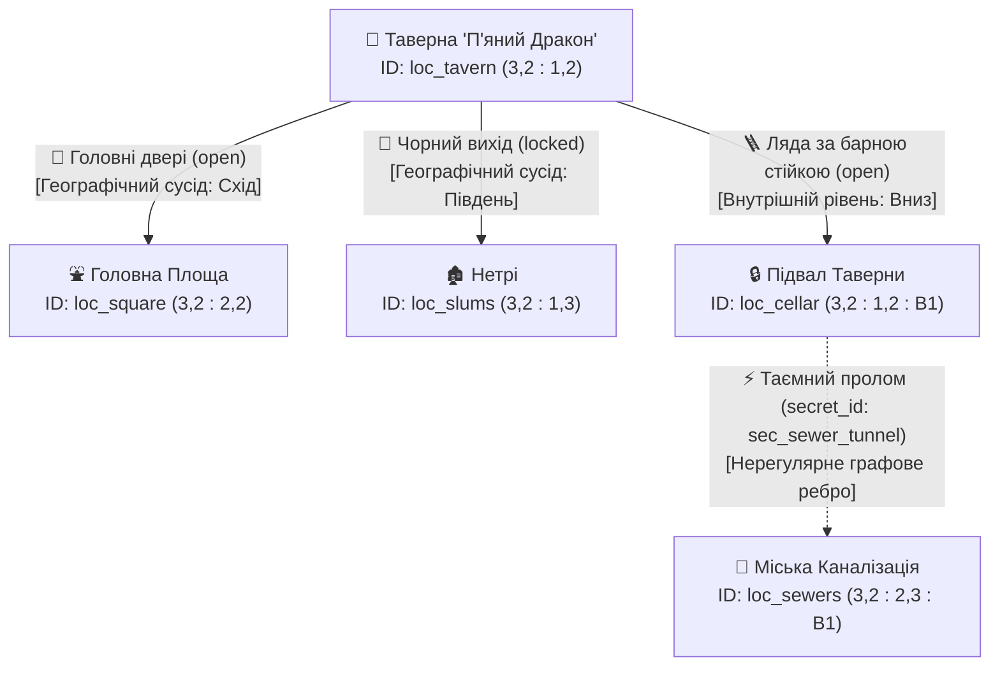

# Специфікація інструментів Агента: Мапа та Локації (Draft)

## 1. Огляд
Цей модуль описує архітектуру, структуру даних, програмні інтерфейси (Function Calling) та способи UI-відображення для географічного простору гри. Він дозволяє ШІ-Майстру розуміти топологію світу, розраховувати переміщення, керувати динамічним оточенням та подавати гравцеві релевантний контекст без токенного вибуху.

---

## 2. Топологія: Розріджена Ієрархічна Матриця + Графова Проекція
Для рольової симуляції простір моделюється як гібридна система **"Матриця для зберігання/UI → Граф для ШІ-Майстра"**:
- **Розріджена Ієрархічна Матриця (Sparse Hierarchical Matrix)**: Простір ділиться на координатні сітки `(x, y, z/layer)`. Кожна клітинка (тайл) може бути "батьком" для вкладеної внутрішньої матриці вищого деталювання:
  * `Region Matrix` (Глобальна мапа регіону, де клітинка — це сектор лісу, моря чи місто).
  * `Settlement / Zone Matrix` (Міська чи локальна сітка, вкладена в клітинку регіону, де клітинки — це вулиці, площі або будівлі).
  * `Interior / Dungeon Topology (Дворежимна топологія інтер'єрів)`: Вкладені приміщення діляться на 2 режими залежно від масштабу та складності:
    1) **Прості POI (Атомарний тайл)** — таверни, звичайні будинки, дрібні крамниці. Не створюють зайвої вкладеної сітки; моделюються як єдиний тайл із багатим текстовим описом, списком присутніх NPC/предметів та 1-2 внутрішніми переходами (наприклад, "Сходи в підвал").
    2) **Складні Багаторівневі Підземелля (3D-Матриця `x, y, z`)** — фортеці, вежі чарівників, багатоповерхові катакомби. Кожен поверх — це зріз матриці за віссю `z` (наприклад, `z = 0` 1-й поверх, `z = -1` підвал, `z = -2` глибинні печери). Кімнати, коридори та тунелі мають точні координати `(x, y, z)`, що дозволяє зберігати точну геометрію будівлі, малювати гравцеві повноцінну міні-мапу з "Туманом війни" (Fog of War) та точно вказувати ШІ-Майстру напрямки вертикальних зв'язків (сходи, шахти, пастки-провалля). Оскільки гра є текстовою і наративною, тут немає автоматичного фізичного рушія: коли гравець наступає на пастку або спускається сходами, ШІ-Майстер описує це суворо наративно в чаті й самостійно викликає тул `move_player`, переміщуючи персонажа на відповідний поверх (наприклад, з `(2,2,-1)` у `(2,2,-2)`).
- **Водні шляхи та дороги**: Завдяки матричній основі річки, дороги та гірські хребти моделюються як безперервна послідовність суміжних клітинок, що спрощує математичні розрахунки подорожей та відображення на міні-мапі.
- **Графова Проекція для ШІ (DAL Adjacency Projection)**: ШІ не вміє рахувати 2D-координати. Тому при запиті контексту бекенд (Data Access Layer) автоматично перетворює поточну клітинку та її сусіди на **список спрямованих виходів (Екзитів)** у форматі графової суміжності.
- **Нерегулярні зв'язки (Custom Transitions)**: Крім фізичних сусідів по сітці, будь-яка клітинка може містити явні графові ребра (телепорти, таємні ходи, сходи), які з'єднують дві довільні точки простору, ігноруючи сітку.

---

### 2.1. Візуалізація карти та Приклад топології
Для наочного розуміння того, як поєднуються 2D-матриця та графова проекція для ШІ, розглянемо трирівневий приклад:

#### Рівень 1: Глобальна мапа регіону (Матриця 4х3, Parent: `world_01`)
*Людина та UI бачать зрозумілу карту, де річка безперервно тече з заходу на південь, а в центрі лежить місто Валоріс.*
| Y \ X | 1 (Захід) | 2 (Центр-Захід) | 3 (Центр-Схід) | 4 (Схід) |
|---|---|---|---|---|
| **1 (Північ)** | 🌲 Ліс `(1,1)` | 🌲 Ліс `(2,1)` | ⛰️ Гори `(3,1)` | ⛰️ Гори `(4,1)` |
| **2 (Центр)** | 🌊 Річка `(1,2)` | 🌊 Річка `(2,2)` | 🏰 **Валоріс** `(3,2)` | 🛣️ Тракт `(4,2)` |
| **3 (Південь)**| 🌊 Річка `(1,3)` | 🌾 Поля `(2,3)` | 🌾 Поля `(3,3)` | 🌲 Ліс `(4,3)` |

#### Рівень 2: Вкладена міська мапа Валоріса (Матриця 3х3, Parent: `world_01:3,2`)
*Зумуємо в клітинку `(3,2)`. Тут координати успадковують батьківський простір:*
| Y \ X | 1 (Західний район) | 2 (Центральний район) | 3 (Східний район) |
|---|---|---|---|
| **1 (Північ)** | 🛡️ Казарми `(1,1)` | 🏛️ Ратуша `(2,1)` | ⛩️ Північна Брама `(3,1)` |
| **2 (Центр)** | 🍺 **Таверна** `(1,2)` | ⛲ Головна Площа `(2,2)` | 🏪 Ринок `(3,2)` |
| **3 (Південь)**| 🏚️ Нетрі `(1,3)` | ⛩️ Південна Брама `(2,3)` | ⚓ Порт `(3,3)` |

#### Рівень 3: Графова Проекція для ШІ-Майстра (Що бачить модель у Таверні)
*Коли гравець знаходиться в Таверні `(world_01 : 3,2 : 1,2)`, бекенд перетворює матрицю та приховані зв'язки на такий спрямований граф виходів:*



**Те, що отримує ШІ-Майстер у JSON-контексті ( DAL Adjacency Projection ):**
```json
{
  "current_location": {
    "location_id": "loc_tavern",
    "name": "Таверна 'П'яний Дракон'",
    "hierarchy_path": "Авалон / Валоріс / Таверна",
    "public_description": "Шумний зал із запахом смаженого м'яса та елю.",
    "exits": [
      { "direction": "Схід", "destination_name": "Головна Площа", "access_status": "open", "type": "grid_neighbor" },
      { "direction": "Південь", "destination_name": "Нетрі", "access_status": "locked", "type": "grid_neighbor" },
      { "direction": "Вниз", "destination_name": "Підвал Таверни", "access_status": "open", "type": "interior_stairs" }
    ],
    "present_npcs": ["npc_edgar_barkeep"],
    "present_items": ["item_old_mug"]
  }
}
```
*(Зверніть увагу: таємний пролом у підвалі не виводиться, поки гравець не спуститься в підвал і не розкриє секрет `sec_sewer_tunnel`!)*

---

### 2.2. Схема переходу та Графових ребер (Transition Schema)
Переходи (Екзити) — це об'єкти, які відповідають за зв'язок між вузлами графа та клітинками матриці. Вони містять:
- **`transition_id`**: Унікальний ідентифікатор ребра (наприклад, `tr_tavern_to_square`).
- **`direction_label`**: Напрямок або назва для інтерфейсу та промпту (наприклад, `"Схід"`, `"Вниз"`, `"Дубові двері"`).
- **`target_location_id`**: Цільовий вузол (куди веде перехід).
- **`transition_type`**: `grid_neighbor` (суміжна клітинка по сітці) | `interior_stairs` (сходи/вертикальний зв'язок) | `custom_secret` (нерегулярний таємний хід) | `portal` | `road` | `waterway`.
- **`discovery_status`**: `visible` | `hidden` | `discovered` (Статус відомості переходу для гравця).
  * `visible`: Звичайні двері, дороги, сходи. Завжди відображаються в UI та `NAVIGATION_MODE`.
  * `hidden`: Прихований прохід (прив'язаний до `secret_id`). Повністю відсікається в клієнтському UI та у швидкому `NAVIGATION_MODE` для Майстра, поки таємниця не буде наративно розкрита!
  * `discovered`: Знайдений гравцем таємний хід. Відображається в UI та `NAVIGATION_MODE` зі спеціальною візуальною позначкою (наприклад, `⚡ [Виявлений секрет]`), щоб гравець і ШІ-Майстер миттєво впізнавали та знаходили його в списку виходів!
- **`access_status`**: `open` | `locked` | `blocked` | `conditional` (Фізична можливість пройти через вихід, незалежна від статусу відомості).
- **`lock_details`**: Параметри замка (наприклад, `key_id: "item_brass_key"`, `lockpick_dc: 15`).
- **`travel_properties`**: 
  * `time_minutes`: Час переміщення (для автоматичного просування внутрішньоігрового годинника при виклику тула `move_player`).
  * `hazard_level`: Рівень ризику (`none | low | medium | high` для генерації випадкових зустрічей чи перешкод у регіональних подорожах).

---

## 3. Ініціалізація та генерація рівнів (Level Initialization)
- **Регіональний рівень (World/Region Level — Попередня генерація)**: Глобальна мапа створюється та фіксується заздалегідь на етапі створення світу/гри. Вона визначає кліматичні зони, фракційний контроль, безперервні водні шляхи/дороги та **насиченість природи маною (`mana_density`)** (числове значення від **0 до 100**). Це значення безпосередньо впливає на швидкість природної регенерації мани з повітря, а також визначає еволюційну та лорну специфіку флори і фауни в секторі.
- **Рівень поселень та відкритих зон (Settlement/Zone Level — Псевдорандомна генерація на льоту)**: На етапі створення світу поселення зберігається як загальний тайл із генераційним каркасом (`settlement_blueprint`), де вказані розмір, населення, спеціалізація та рівень небезпеки. Детальні будівлі, вулиці та внутрішні переходи створюються **псевдорандомно на льоту** (на основі позиції міста на карті, біому, сусідніх регіонів та параметрів каркасу) саме в той момент, коли це потрібно ШІ-Майстру або коли гравець досліджує район. Поселення автоматично успадковує `mana_density` від батьківського регіонального тайла.
- **Кімнатний/Підземний рівень (Dungeons / Interiors — Генерація за запитом Майстра)**: Підземелля та складні закриті структури генеруються **за явним запитом ШІ-Майстра** (через спеціальний тул генерації) у момент, коли сюжету потрібна нова локація для загадки, культу, ордену чи квесту. ШІ-Майстер передає параметри генерації (стиль, кількість поверхів, тема, рівень небезпеки, перекриття `mana_density`), після чого система створює 3D-матрицю `(x, y, z)`, розміщує пастки, таємниці й об'єкти та фіксує їх у БД. Завдяки цьому Майстер може видавати гравцеві карти підземелля, чутки про конкретні кімнати чи ключі задовго до того, як персонаж фізично туди потрапить.

---

## 4. Динамічний стан та Секрети локації
Локації є динамічними сутностями, що змінюються під впливом дій гравця та подій світу:
- **Статус дослідження (`discovery_status`)**: `undiscovered` | `discovered` | `visited`.
- **Доступність (`access_status`)**: `open` | `locked` | `hidden` | `blocked` | `danger_zone`.
- **Навколишнє середовище (`environmental_state`)**: Рівень освітлення, погода, тимчасові ефекти (пожежа, затоплення, магічний туман).
- **Модифікації стану та Наративне очищення (`state_modifications`)**: Замість жорстких таймерів у коді, всі зміни (руйнування, написи, залишені предмети чи глобальні події як війна чи чума) зберігаються з внутрішньоігровим таймкодом (`timestamp`) і поширюються **ієрархічно зверху вниз** (від регіону до поселень і кімнат). При візиті або розрахунку сцени ШІ-Майстер аналізує минулий час, біом та відстань до епіцентру, після чого наративно вирішує долю об'єктів чи силу воєнного/кліматичного впливу, вплітає зміни в `public_description` та видаляє застарілі модифікації через тул `update_location_state`.
- **Секрети локації (`secrets`)**: Таємні проходи, сховані важелі чи пастки. 
  * *Принцип відображення:* Використовується надійний ключ `secret_id`. Розкриття подається суворо наративно в чаті і залишає органічний слід у `public_description`, без гейміфікованих UI-плашок.

---

## 5. Оптимізація контексту для Майстра (AI Context Optimization)
Для економії токенів і швидкої роботи ШІ використовується 3 режими витягування даних:
1. **`NAVIGATION_MODE` (Швидкий рух)**: Назва, стислий публічний опис, список явних виходів (зі статусами доступності) та перелік присутніх NPC/предметів.
2. **`DETAILED_MODE` (Дослідження та взаємодія)**: Повний сенсорний опис, історія, приховані деталі та нерозкриті секрети (для перевірки уважності гравця).
3. **`REGIONAL_MODE` (Глобальна мапа)**: Огляд батьківського регіону, сусідніх локацій та розрахунок часу/ризиків подорожі.

- **Динамічне формування присутності NPC (Dynamic Schedule Presence)**: Замість статичної прив'язки персонажів до локації 24/7, бекенд при виклику `get_location_context` динамічно розраховує список присутніх у сцені NPC на основі поточного ігрового часу та їхнього розкладу (день/ніч, робота/дім). Водночас ШІ-Майстер має повний пріоритет (Narrative Override) і може переміщувати персонажів залежно від сюжетних подій (тривога, напад монстрів, фестиваль).

---

## 6. Інструменти Майстра (Function Calling API)
Цей підрозділ визначає повний набір технічних контрактів функцій (CRUD + семантичні дії), якими ШІ-Майстер читає, переміщує персонажів та модифікує стан локацій на бекенді. Це структуровані JSON-інструменти (Tool Calling / Function Calling):

### 1. Пошук та Читання контексту (Retrieval & Navigation)
- **`get_location_context(location_id: string, mode: "NAVIGATION_MODE" | "DETAILED_MODE" | "REGIONAL_MODE")`**
  * *Призначення*: Отримання структурованих даних тайла локації у вказаному токен-оптимізованому режимі. Бекенд автоматично фільтрує приховані секрети та динамічно розраховує список присутніх NPC за їхнім розкладом та ігровим часом.
- **`search_locations(query: string, filters?: { type?: string, parent_location_id?: string, discovery_status?: string })`**
  * *Призначення*: Пошук локацій за назвою, типом чи регіоном у БД без завантаження всієї карти світу.
- **`calculate_distance(source_location_id: string, target_location_id: string)`**
  * *Призначення*: Розрахунок географічної (у тайлах/кілометрах) або топологічної відстані та шляху між двома вузлами. Використовується Майстром для оцінки сили впливу регіональних війн на конкретне місто, розрахунку часу подорожі чи дальності магії.

### 2. Навігація та Переміщення (Movement & Time Progression)
- **`move_player(destination_location_id: string, travel_time_minutes: number, travel_summary?: string)`**
  * *Призначення*: Переміщення гравця (та його супутників) у цільову локацію. Бекенд автоматично просуває внутрішньоігровий годинник на `travel_time_minutes`, оновивши статуси розкладів NPC і глобальних таймерів.

### 3. Модифікація стану та Секрети (State Modification & Secrets)
- **`update_location_state(location_id: string, updates: { public_description?: string, lighting?: string, weather?: string, active_hazards?: string[], add_state_modification?: object, remove_modification_ids?: string[] })`**
  * *Призначення*: Атомарна зміна навколишнього середовища, додавання нового запису до журналу `state_modifications` (з таймкодом) або очищення застарілих наслідків при повторному візиті (Narrative Garbage Collection).
- **`update_transition_status(location_id: string, transition_id: string, access_status?: "open" | "locked" | "blocked" | "conditional", lock_details?: object)`**
  * *Призначення*: Зміна фізичного стану проходу (наприклад: гравець зламав замок, забарикадував двері або стався завал тунелю).
- **`reveal_location_secret(location_id: string, secret_id: string)`**
  * *Призначення*: Розкриття прихованого ходу, схованки чи пастки за надійним технічним ключем `secret_id`. Переводить статус таємниці та відповідного переходу з `hidden` у `discovered`, вплітаючи знахідку в наратив без UI-плашок.

### 4. Динамічна генерація (Procedural Generation & Creation)
- **`create_location(parent_location_id: string | null, location_data: object, blueprint_override?: object)`**
  * *Призначення*: Динамічне створення нової кімнати, будівлі чи підземелля "на льоту" (за запитом Майстра або при генерації поселення з `settlement_blueprint`). Система створює запис у SQLite і зв'язує його ребрами `transitions` із батьківським та сусідніми тайлами.

---

## 7. Відображення на UI (Frontend Representation — Player UI Only)
Оскільки Майстер є автономним ШІ-агентом, інтерфейс адміністрування чи інспектора для людини **відсутній**. Усі зміни прихованих станів виконуються програмно через тул-коли Майстра.

### 1. Ізоляція даних та Чистий Наратив
- **Сувора безпека даних**: Приховані пастки, секретні двері (`hidden`) та внутрішні нотатки Майстра суворо відсікаються бекендом при формуванні відповіді для клієнта.
- **Пріоритет чату над кнопками (No Action Buttons)**: Мапа, список виходів та перелік об'єктів у бічній панелі призначені **виключно для орієнтування та сприйняття світу**. Вони НЕ містять інтерактивних кнопок переміщення чи автопідстановки команд у чат; усі дії та переходи гравець здійснює виключно наративно через текстове введення!

### 2. Елементи головного екрана (Main Layout)
- **Навігаційна шапка (Location Breadcrumb Header)**: Відображає поточний ієрархічний шлях персонажа (наприклад: *Королівство Валоріс / Місто Авалон / Таверна "П'яний Дракон"*).
- **Бічна панель оточення (Environment Sidebar)**:
  * **Виходи**: Список явних виходів із зазначенням напрямку та статусу доступності (`Відкрито`, `Замкнено`, `Заблоковано`).
  * **Присутні NPC та Предмети**: Відображає тільки тих персонажів та речі, які перебувають безпосередньо в поточній локації поруч із гравцем.
- **Адаптивність (Mobile UX)**: На смартфонах бічна панель ховається в гамбургер-меню (drawer), а модальні вікна розгортаються на весь екран.

### 3. Модальне вікно Інтерактивної Мапи (Global Interactive Map Modal)
- **Виклик та Навігація між рівнями**: При кліку на міні-мапу або кнопку в шапці відкривається модальне вікно інтерактивної мапи світу. Гравець може вільно перемикатися між рівнями масштабу (Регіональна карта $\leftrightarrow$ Карта поселення $\leftrightarrow$ Внутрішні плани будівель/підземель).
- **Пошук та Ретроспектива (Historical Inspection)**:
  * Модальне вікно містить рядок пошуку за назвою серед уже відкритих чи відвіданих міст і локацій.
  * Гравець може клікнути на будь-яке старе або відвідане місце на карті, щоб освіжити в пам'яті його структуру, виходи та публічний опис.
  * **Обмеження огляду (Fow / Live State Filtering)**: При перегляді віддаленої локації (де персонажа зараз немає фізично) система показує **лише карту та публічний опис**, суворо приховуючи поточний живий стан присутніх NPC та предметів (оскільки персонаж не може бачити, хто зараз перебуває в таверні іншого міста)!

---

## 8. Схеми даних
Для детальної структури даних кожного тайла локації та JSON-схеми дивіться файл: `docs/features/specs/location_data_schema.md`.
Ця схема об'єднує:
1. **Просторову ієрархію**: Зв'язок 2D/3D-сітки (`parent_location_id`, `matrix_coordinates`).
2. **Графові переходи**: Спрямовані виходи, закриті та приховані шляхи (`transitions`).
3. **Динамічне середовище та Журнал змін**: Магічна насиченість (`mana_density`), небезпеки та таймкоди модифікацій (`state_modifications`).
4. **Зв'язок із сутностями**: Пул місцевих NPC та предмети інвентаря (`connected_entities`).
