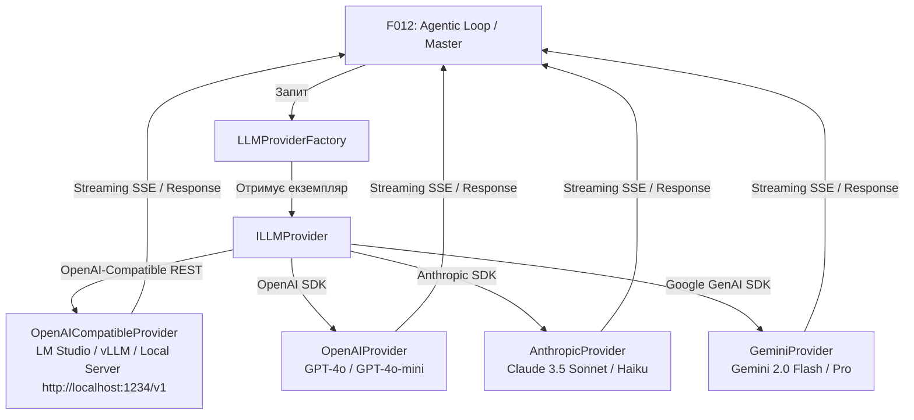
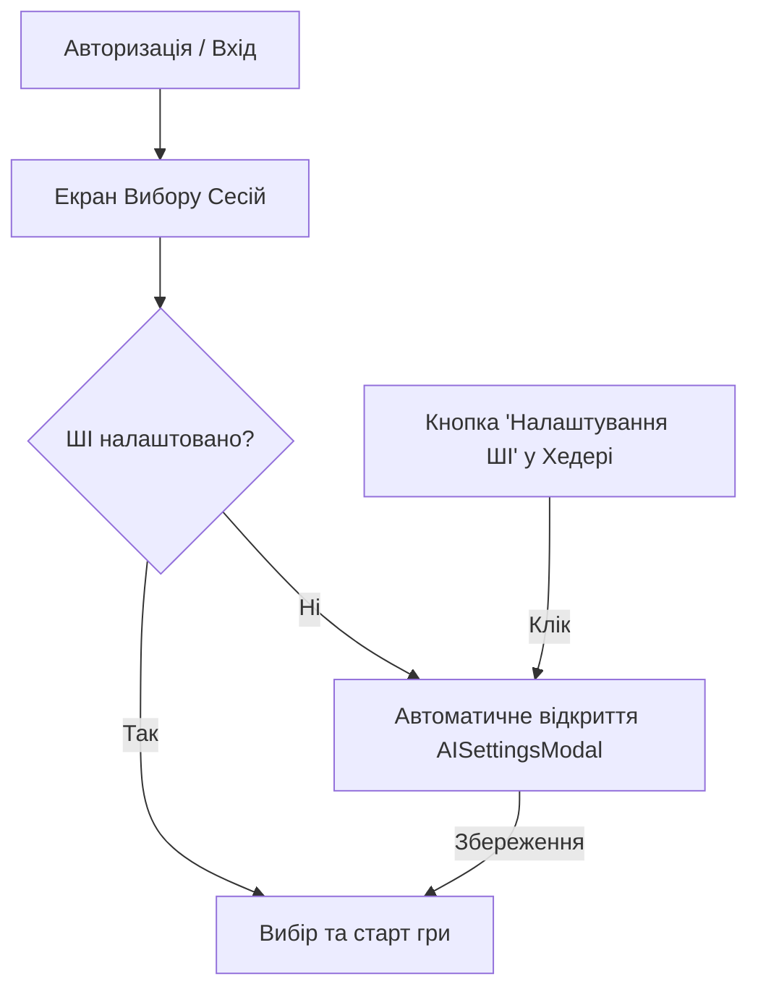

# Специфікація: Інтеграція ШІ-моделей (F020)

Цей документ описує архітектуру, інтерфейси, UI-компоненти та логіку роботи уніфікованого модуля інтеграції з Великими Мовними Моделями (LLM). Фіча F020 є критичним інфраструктурним шаром проєкту *Master of Game*, який забезпечує зв'язок між Агентним циклом (F012) та провайдерами ШІ (першочергово **OpenAI-сумісними локальними серверами, такими як LM Studio**, а також закладеною архітектурною підтримкою OpenAI, Anthropic, Google Gemini).

> [!IMPORTANT]
> **Ключові принципи та обмеження версії:**
> 1. **Універсальна підтримка OpenAI-сумісних API (`openai_compatible`):** Локальне підключення реалізовано через стандартизований OpenAI REST HTTP API (`/v1/chat/completions`). Це означає, що гра **не прив'язана жорстко лише до LM Studio** — користувач може підключити **будь-який сервер**, який імплементує формат OpenAI (LM Studio, vLLM, LocalAI, Jan.ai, LiteLLM або власні локальні/мережеві проксі), просто вказавши його Base URL! **LM Studio** залишається рекомендованим пресетом за замовчуванням (`http://localhost:1234/v1`).
> 2. **Єдина Головна LLM + Embedding Модель (Single LLM Architecture):** Зважаючи на орієнтацію на локальне використання та обмеження VRAM споживчих ПК, система використовує **одну головну LLM модель** для всіх завдань (Наративний Майстер, Сабагенти, Стиснення) плюс локальну модель векторизації з фічі F017 (`fastembed-js`).
> 3. **Фокус на моделях із нативною підтримкою Tool Calling:** Використовуються локальні та хмарні моделі, що підтримують стандартизований виклик інструментів (OpenAI-compatible `tools`).
> 4. **Можливість вимкнення таймауту:** Оскільки гра покрокова, користувач може прибрати ліміт часу (`timeoutMs = 0`), щоб дати можливість повільним ПК згенерувати відповідь.
> 5. **Локальна система Ollama НЕ підтримується** (показала незадовільну якість та нестабільність під час попередніх тестів).
> 6. **LM Studio / OpenAI-Compatible** — єдиний провайдер, що повноцінно тестується під час розробки. Хмарні провайдери закладені на рівні коду, але не проходитимуть e2e тестування через відсутність платних API-ключів.

---

## 1. Архітектурний огляд та Паттерн Провайдера

Всі виклики моделей здійснюються через єдину точку входу — **`LLMProviderFactory`** та уніфікований інтерфейс **`ILLMProvider`** (Паттерн "Стратегія").



---

## 2. Уніфікований Інтерфейс `ILLMProvider`

Кожен адаптер провайдера імплементує базовий інтерфейс `ILLMProvider`.

```typescript
export interface ILLMProvider {
  readonly providerId: LLMProviderId; // 'openai_compatible' | 'openai' | 'anthropic' | 'gemini'
  
  /**
   * Стандартна генерація відповіді (для Сабагентів та JSON-інструментів)
   */
  generate(request: LLMCompletionRequest): Promise<LLMCompletionResponse>;

  /**
   * Потокова генерація (для Наративного Майстра та виводу в Чат)
   */
  stream(request: LLMCompletionRequest): AsyncIterable<LLMStreamChunk>;

  /**
   * Перевірка доступності провайдера та валідності API-ключа/ендпоінта
   */
  validateCredentials(): Promise<ValidationResult>;
}
```

### 2.1. Структура Запиту (`LLMCompletionRequest`)

```typescript
export interface LLMCompletionRequest {
  model: string; // Назва моделі, завантаженої в локальний сервер (LM Studio / vLLM) або хмарної моделі
  messages: LLMMessage[];
  temperature?: number; // За замовчуванням 0.7
  maxTokens?: number;
  tools?: LLMToolDefinition[]; // Стандартний масив інструментів для Tool Calling
  toolChoice?: 'auto' | 'none' | 'required';
  timeoutMs?: number; // 0 означає без обмеження за часом (Disabled Timeout)
}
```

---

## 3. Специфікація Провайдерів

### 3.1. OpenAI-Compatible / LM Studio Provider (`OpenAICompatibleProvider`) — ОСНОВНИЙ
- **Універсальність:** Підтримує **будь-який локальний або віддалений сервер**, який імплементує специфікацію OpenAI REST HTTP API (`/v1/chat/completions` та `/v1/models`).
- **Пресети за замовчуванням:** **LM Studio** (`http://localhost:1234/v1`), але може бути легко змінений на vLLM (`http://localhost:8000/v1`), LocalAI, Jan.ai або власний HTTP proxy.
- **Підтримувані моделі:** Будь-які сучасні інструкційні GGUF/Safetensors моделі з підтримкою Tool Calling (наприклад, `Qwen2.5-7B/14B-Instruct`, `Llama-3.1-8B-Instruct`, `Hermes-3-Llama-3.1-8B`, `Mistral-7B-Instruct-v0.3`).
- **Особливості:**
  - **Повна автономність, приватність та свобода вибору софту.**
  - **Нативна підтримка Tool Calling:** Передає стандартний масив `tools` у JSON-тілі запиту.
  - **Гнучке керування таймаутом:** Можливість встановити як конкретне значення (напр. 180с), так і повністю **вимкнути таймаут** (`timeoutMs = 0`).
  - **Один провайдер для всіх завдань:** Єдина завантажена в сервер модель виконує ролі Майстра, Сабагентів та Стиснення.

### 3.2. Хмарні провайдери (OpenAI, Anthropic, Gemini) — АРХІТЕКТУРНІ
> [!NOTE]
> Хмарні провайдери реалізуються як класи-адаптери, але **не проходять e2e тестування** через відсутність API-ключів у розробника.

- **`OpenAIProvider`**: `gpt-4o`, `gpt-4o-mini`.
- **`AnthropicProvider`**: `claude-3-5-sonnet`, `claude-3-5-haiku`.
- **`GeminiProvider`**: `gemini-2.0-flash`, `gemini-1.5-pro`.

---

## 4. Конфігурація Моделей (Single LLM + Embeddings)

З огляду на обмеження ресурсів споживчих ПК, система **відмовляється від мультимодельного запуску різних LLM** під час локальної гри. 

Користувач обирає **одну головну LLM модель** для генерації плюс **модель векторизації (Embeddings)** з специфікації F017.

```typescript
export interface UserAISettings {
  userId: string;
  // Головна LLM
  providerId: 'openai_compatible' | 'openai' | 'anthropic' | 'gemini';
  customEndpoint?: string; // Наприклад: "http://localhost:1234/v1" (для LM Studio) або "http://localhost:8000/v1" (для vLLM)
  apiKey?: string; // Опціонально для локальних / обов'язково для хмарних
  modelName: string; // Назва моделі у локальному сервері або хмарі
  temperature: number;
  timeoutMs: number; // 0 = Без таймауту (Unlimited)
  
  // Векторизація (F017)
  embeddingProvider: 'fastembed' | 'openai';
}
```

---

## 5. Потоковий Вивід (Streaming Engine) та Провайдер-Специфічні Помилки

Відповідь Наративного Майстра транслюється на фронтенд через **Server-Sent Events (SSE)** (`POST /api/v1/chat/stream`).

У разі виникнення сбоїв бекенд повертає структуровану помилку, **деталі та текст якої залежать від конкретного провайдера**:

```typescript
export interface ProviderErrorEvent {
  code: string;
  providerId: 'openai_compatible' | 'openai' | 'anthropic' | 'gemini';
  message: string;
  details?: Record<string, any>;
}
```

### Приклади помилок за провайдерами:

- **OpenAI-Compatible / LM Studio (`openai_compatible`):**
  ```json
  {
    "code": "LOCAL_SERVER_UNREACHABLE",
    "providerId": "openai_compatible",
    "message": "Не вдалося з'єднатися з локальним ШІ-сервером за адресою http://localhost:1234/v1. Перевірте, чи запущено LM Studio / vLLM та чи ввімкнено Local Server."
  }
  ```

- **OpenAI (`openai`):**
  ```json
  {
    "code": "OPENAI_QUOTA_EXCEEDED",
    "providerId": "openai",
    "message": "Перевищено ліміт балансу або квот OpenAI API (Error 429). Перевірте налаштування оплати в профілі OpenAI."
  }
  ```

- **Anthropic (`anthropic`):**
  ```json
  {
    "code": "ANTHROPIC_INVALID_KEY",
    "providerId": "anthropic",
    "message": "Невалідний API Key Anthropic (Error 401). Перевірте введений ключ у налаштуваннях ШІ."
  }
  ```

---

## 6. Обробка Помилок та Повідомлення Користувача

1. **Відсутність обов'язкового Fallback:** Якщо єдиний налаштований провайдер недоступний, система **не намагається** переключатися на неіснуючу резервну модель.
2. **Передача помилки у UI:** Помилка перехоплюється, описується зрозумілою мовою для гравця (відповідно до провайдера) і відображається у модальному вікні чату або через системне сповіщення UI.

---

## 7. Безпека та Збереження Налаштувань

- **Відсутність серверних ключів:** Усі налаштування та ключі є на 100% користувацькими (`user_ai_settings`).
- **Шифрування:** API-ключі зберігаються в зашифрованому вигляді (`AES-256-GCM`).

---

## 8. UI-Інтерфейс Конфігурації (`AISettingsModal` & Header Integration)

Попап `AISettingsModal` розробляється для початкового налаштування та подальшого редагування ШІ-параметрів.

### 8.1. Сценарії Відображення

1. **Автоматичний запуск після авторизації:** Відкривається автоматично при переході на екран Вибору Сесій (F004), якщо `user_ai_settings` ще не налаштовані.
2. **Ручний виклик з Хедера:** Кнопка з іконкою ШІ/шестерні у верхній панелі на екрані Вибору Сесій.



### 8.2. Динамічна Форма `AISettingsModal`

Форма адаптує свої поля залежно від обраного провайдера:

```
+-------------------------------------------------------------------+
|                     Налаштування ШІ (AI Settings)                 |
+-------------------------------------------------------------------+
| [1. ГОЛОВНА LLM МОДЕЛЬ]                                            |
| Провайдер:              [ OpenAI-Compatible (LM Studio, vLLM) v ] |
|                                                                   |
| -- Динамічні поля для OpenAI-Compatible (LM Studio / vLLM / etc) --|
| Base URL сервера:       [ http://localhost:1234/v1              ] |
| Назва моделі:           [ Qwen2.5-7B-Instruct                ] |
|                         [ Кнопка: Завантажити список моделей    ] |
| API Key (Опціонально):  [                                       ] |
|                                                                   |
| -- (При виборі OpenAI / Anthropic / Gemini поля змінюються) --   |
| API Key (Обов'язково):  [ ••••••••••••••••••••••••••••••••••    ] |
| Модель:                 [ claude-3-5-sonnet-latest           v ] |
|                                                                   |
| -- Загальні параметри --                                         |
| Температура:            [--------o----------] 0.70                |
| Таймаут запиту:         [ 180 ] секунд                            |
|                         [X] Без таймауту (Чекати скільки завгодно)|
|                                                                   |
| [2. МОДЕЛЬ ВЕКТОРИЗАЦІЇ (EMBEDDINGS - F017)]                      |
| Тип векторизатора:      [ FastEmbed (Локально в Node.js)     v ] |
|                                                                   |
| [Тестувати з'єднання]                              [ Зберегти ]  |
+-------------------------------------------------------------------+
```

#### Правила динамічного відображення полів:
- **При виборі `OpenAI-Compatible (LM Studio / Local Server)`:**
  - Відображається поле `Base URL сервера` (рекомендований пресет за замовчуванням `http://localhost:1234/v1`, але користувач може вказати будь-який інший URL, напр., `http://localhost:8000/v1`).
  - Відображається кнопка "Отримати список моделей" (`GET {customEndpoint}/models`).
  - Відображається опціональне поле `API Key` (для серверів з авторизацією, як vLLM або LiteLLM).
- **При виборі `OpenAI`, `Anthropic`, `Google Gemini`:**
  - **Сховується** поле `Base URL сервера`.
  - Відображається обов'язкове масковане поле `API Key`.
  - Поле `Модель` стає випадаючим списком підтримуваних хмарних моделей.

---

## 9. Схема Бази Даних та REST API Контракти

### 9.1. Схема Бази Даних (SQLite / `user_ai_settings`)

```sql
CREATE TABLE IF NOT EXISTS user_ai_settings (
    user_id TEXT PRIMARY KEY,
    provider_id TEXT NOT NULL DEFAULT 'openai_compatible',
    custom_endpoint TEXT DEFAULT 'http://localhost:1234/v1',
    encrypted_api_key TEXT,
    model_name TEXT NOT NULL DEFAULT 'Qwen2.5-7B-Instruct',
    temperature REAL NOT NULL DEFAULT 0.7,
    timeout_ms INTEGER NOT NULL DEFAULT 0, -- 0 = Без таймауту
    embedding_provider TEXT NOT NULL DEFAULT 'fastembed',
    is_configured BOOLEAN NOT NULL DEFAULT 1,
    created_at DATETIME DEFAULT CURRENT_TIMESTAMP,
    updated_at DATETIME DEFAULT CURRENT_TIMESTAMP,
    FOREIGN KEY (user_id) REFERENCES users(id) ON DELETE CASCADE
);
```

### 9.2. REST API Ендпоінти

#### 1. Отримати налаштування ШІ користувача
- **HTTP Method:** `GET /api/v1/ai/settings`
- **Response `200 OK`:**
```json
{
  "isConfigured": true,
  "providerId": "openai_compatible",
  "customEndpoint": "http://localhost:1234/v1",
  "modelName": "Qwen2.5-7B-Instruct",
  "temperature": 0.7,
  "timeoutMs": 0,
  "embeddingProvider": "fastembed",
  "hasApiKey": false
}
```

#### 2. Зберегти налаштування ШІ користувача
- **HTTP Method:** `PUT /api/v1/ai/settings`
- **Request Body:**
```json
{
  "providerId": "openai_compatible",
  "customEndpoint": "http://localhost:1234/v1",
  "modelName": "Qwen2.5-7B-Instruct",
  "temperature": 0.7,
  "timeoutMs": 0,
  "embeddingProvider": "fastembed",
  "apiKey": null
}
```

#### 3. Тестування з'єднання з провайдером
- **HTTP Method:** `POST /api/v1/ai/test-connection`
- **Request Body:**
```json
{
  "providerId": "openai_compatible",
  "customEndpoint": "http://localhost:1234/v1",
  "apiKey": null
}
```
- **Response `200 OK` (Сервер знайдено):**
```json
{
  "success": true,
  "message": "Успішне з'єднання з OpenAI-сумісним сервером",
  "latencyMs": 35,
  "availableModels": ["Qwen2.5-7B-Instruct", "Llama-3.1-8B-Instruct"]
}
```
- **Response `400 Bad Request` (Помилка підключення):**
```json
{
  "success": false,
  "error": {
    "code": "LOCAL_SERVER_UNREACHABLE",
    "providerId": "openai_compatible",
    "message": "Неможливо з'єднатися з локальним сервером за адресою http://localhost:1234/v1."
  }
}
```

---

## 10. План тестування (Verification Plan)

### 10.1. Модульні та Інтеграційні Тести (OpenAI-Compatible Only)
- Перевірка виконання REST-запитів `OpenAICompatibleProvider` до стандартизованих ендпоінтів `/v1/chat/completions` та `/v1/models`.
- Перевірка коректності роботи з різними Base URL (наприклад, LM Studio `http://localhost:1234/v1` або vLLM `http://localhost:8000/v1`).
- Перевірка коректності прокидання та обробки опції безлімітного таймауту (`timeoutMs = 0`).
- Перевірка генерації специфічних для провайдера об'єктів помилок.
- Тестування збереження та дешифрування налаштувань у таблиці `user_ai_settings`.

### 10.2. Тестування UI (Frontend)
- Автоматичний виклик `AISettingsModal` на сторінці вибору сесій для нових користувачів.
- Перевірка динамічного приховування/відображення полів (Base URL vs Cloud API Key) при зміні провайдера в формі.
- Перевірка роботи кнопки завантаження списку моделей з локального сервера.
- Перевірка роботи чекбоксу "Без таймауту".
