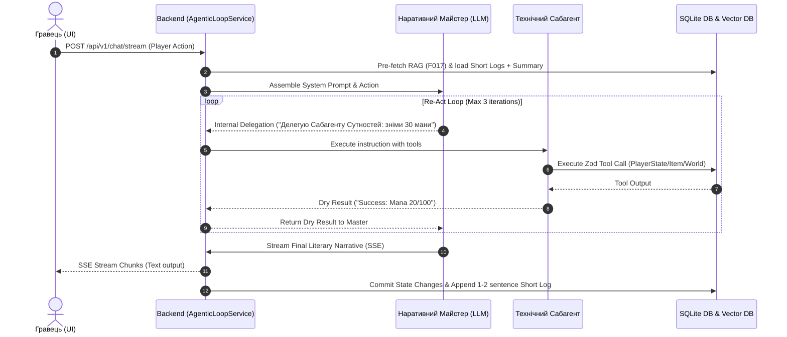

# Implementation Plan - F012: Агентний цикл (Agentic Loop)

Фіча F020/F012 реалізує основний робочий цикл ШІ (Agentic Loop) для проєкту *Master of Game*, адаптований для локальних LLM. Головна мета — стабільність генерації JSON, утримання художньої стилістики, подвійний контекст (Long/Short), автоматичне та ручне стиснення пам'яті (80/20 rule), та потоковий вивід оповіді (SSE Streaming).

## User Review Required

> [!IMPORTANT]
> **Ключові архітектурні рішення:**
> 1. **Паттерн Наративний Майстер + Спеціалізовані Сабагенти:**
>    - **Наративний Майстер (Оповідач):** Приймає рішення щодо логіки світу, генерує художній текст та відіграє NPC. **Ніколи не викликає API-інструменти напряму.**
>    - **Спеціалізовані Сабагенти (Property, World, Actor):** Ізольовані LLM-промпти для парсингу намірів у валідний JSON та виконання викликів до БД/інструментів. Дозволено крос-доменний доступ до інструментів для уникнення тупикових ситуацій.
> 2. **Подвійний контекст (Dual-Track Context) та Стиснення 80/20:**
>    - **Long Context:** Літературна оповідь для гравця (у промпт Майстра підтягуються лише останні 2-3 повідомлення для стилю).
>    - **Short Context:** Сухі логічні факти поточної сцени ("Гравець пішов на північ", "Витрачено 30 мани").
>    - **Авто-стиснення (80/20):** При досягненні ліміту токенів найстаріші 80% сухого контексту згортаються головною LLM у підсумкове **Саммарі (Summary)**, а 20% залишаються "свіжою пам'яттю". Усі оригінальні логи зберігаються у БД та Vector DB (F017).
> 3. **Ручне стиснення ("Завершити главу"):** Кнопка на UI дозволяє гравцеві очистити дрифт дрібних деталей після завершення сюжетної арки.
> 4. **Re-Act Цикл Майстра:** До 3 ітерацій внутрішнього роздуму/делегування за один хід гравця.
> 5. **SSE Streaming:** Потокова передача оповіді гравцеві в реальному часі (`POST /api/v1/chat/stream`).

---

## 1. Архітектурна діаграма цикла ходу (Turn Workflow)



---

## Proposed Changes

### Backend (`master_of_game_API`)

#### [NEW] [agentic_loop.types.ts](file:///d:/My/MasterOfGame/master_of_game_API/src/types/agentic_loop.types.ts)
Опис типів `TurnContext`, `ShortLog`, `SessionSummary`, `SubagentGroup` (`'property' | 'world' | 'actor'`), `MasterDelegationRequest`, `SubagentExecutionResult`, `SSEEventPayload`, `CompressionConfig`, `CompressionResult`.

#### [NEW] [context_assembly.service.ts](file:///d:/My/MasterOfGame/master_of_game_API/src/services/agentic_loop/context_assembly.service.ts)
Сервіс збірки системного промпту: об'єднання Саммарі, RAG-контексту (F017/F018), нестиснених сухих логів та останніх 2-3 художніх відповідей.

#### [NEW] [subagent_orchestrator.service.ts](file:///d:/My/MasterOfGame/master_of_game_API/src/services/agentic_loop/subagent_orchestrator.service.ts)
Оркестратор сабагентів. Мапить внутрішні команди Майстра на промпти та Zod-інструменти відповідних груп (`property`, `world`, `actor`) із підтримкою крос-доменного виклику.

#### [NEW] [compression.service.ts](file:///d:/My/MasterOfGame/master_of_game_API/src/services/agentic_loop/compression.service.ts)
Сервіс стиснення пам'яті (алгоритм 80/20): згортання 80% найстаріших сухих логів у консолідоване Саммарі через головний `ILLMProvider`. Підтримка примусового ручного стиснення ("Завершити главу").

#### [NEW] [agentic_loop.service.ts](file:///d:/My/MasterOfGame/master_of_game_API/src/services/agentic_loop/agentic_loop.service.ts)
Головний сервіс керування ходом: координація Re-Act циклу (до 3 ітерацій), трансляція SSE-потоків оповіді, фіналізація змін у БД та запис короткого сухого логу.

#### [NEW] [agentic_loop.controller.ts](file:///d:/My/MasterOfGame/master_of_game_API/src/controllers/agentic_loop.controller.ts)
Обробники HTTP-запитів:
- `POST /api/v1/chat/stream` — SSE-потік ходу.
- `POST /api/v1/chat/compress` — ручне стиснення контексту.

#### [NEW] [agentic_loop.routes.ts](file:///d:/My/MasterOfGame/master_of_game_API/src/routes/agentic_loop.routes.ts)
Express роутер із `authMiddleware`. Реєстрація роутів у `src/app.ts` на `/api/v1/chat`.

---

### Frontend (`master_of_game_UI`)

#### [NEW] [agenticLoopApi.ts](file:///d:/My/MasterOfGame/master_of_game_UI/src/features/agentic_loop/api/agenticLoopApi.ts)
Клієнт для підключення до SSE-потоку `POST /api/v1/chat/stream` та виклику ручного стиснення `POST /api/v1/chat/compress`.

#### [NEW] [types/index.ts](file:///d:/My/MasterOfGame/master_of_game_UI/src/features/agentic_loop/types/index.ts)
Типи станів ходу, SSE подій та індикаторів сабагентів.

#### [NEW] [useAgenticLoop.ts](file:///d:/My/MasterOfGame/master_of_game_UI/src/features/agentic_loop/hooks/useAgenticLoop.ts)
Хук управління станом ходу, розбором SSE-потоку, відображенням стадій роздумів Майстра ("збирання пам'яті", "виконання сабагентом", "генерація оповіді") та ручного стиснення.

#### [NEW] [TurnProgressIndicator.tsx](file:///d:/My/MasterOfGame/master_of_game_UI/src/features/agentic_loop/components/TurnProgressIndicator.tsx)
Компонент анімованого індикатора стадій роботи Агентного циклу під час ходу.

#### [NEW] [CompressContextButton.tsx](file:///d:/My/MasterOfGame/master_of_game_UI/src/features/agentic_loop/components/CompressContextButton.tsx)
Кнопка "Завершити главу" для ручного стиснення контексту.

#### [MODIFY] [uk.json](file:///d:/My/MasterOfGame/master_of_game_UI/src/i18n/locales/uk.json)
Локалізація нових статусів, індикаторів та кнопок у секції `"agentic_loop"`.

---

## REST API Контракти

### 1. `POST /api/v1/chat/stream` (SSE Streaming Turn)
- **Headers:** `Content-Type: application/json`, `Accept: text/event-stream`
- **Request Body:**
```json
{
  "sessionId": "sess_12345",
  "actionText": "Я випиваю зілля лікування та атакую орка мечем"
}
```
- **SSE Response Stream Events:**
  - `event: status` -> `data: {"stage": "pre_fetch", "message": "Майстер шукає спогади..."}`
  - `event: status` -> `data: {"stage": "subagent", "subagent": "actor", "message": "Сабагент Сутностей оновлює ману та HP..."}`
  - `event: chunk` -> `data: {"delta": "Ви відкорковуєте пляшечку з червоною рідиною... "}`
  - `event: done` -> `data: {"turnId": "turn_99", "shortLog": "Гравець випив зілля (+20 HP) і завдав орку 12 шкоди."}`

### 2. `POST /api/v1/chat/compress` (Manual Context Compression)
- **Request Body:**
```json
{
  "sessionId": "sess_12345"
}
```
- **Response 200 OK:**
```json
{
  "success": true,
  "summary": "Глава 1 завершена: Гравець здолав орків у печері, знайшов давній клеймор та відновив сили.",
  "compressedLogsCount": 14
}
```

---

## Verification Plan

### Automated Tests
- **Backend Tests (Vitest)**:
  - `npx vitest run src/tests/agentic_loop/context_assembly.test.ts`
  - `npx vitest run src/tests/agentic_loop/subagent_orchestrator.test.ts`
  - `npx vitest run src/tests/agentic_loop/compression_service.test.ts`
  - `npx vitest run src/tests/agentic_loop/agentic_loop_service.test.ts`
- **Frontend Tests (Vitest)**:
  - `npx vitest run src/features/agentic_loop/hooks/useAgenticLoop.test.ts`

### Manual Verification
1. Відправити хід гравця через UI з дією, яка вимагає зміни інвентарю та параметрів персонажа.
2. Спостерігати за анімованим індикатором стадій ("Збирання пам'яті" -> "Делегування Сабагенту Сутностей" -> "Генерація оповіді").
3. Перевірити потоковий вивід тексту через SSE.
4. Натиснути кнопку "Завершити главу" (ручне стиснення) та перевірити створення нового Саммарі.
