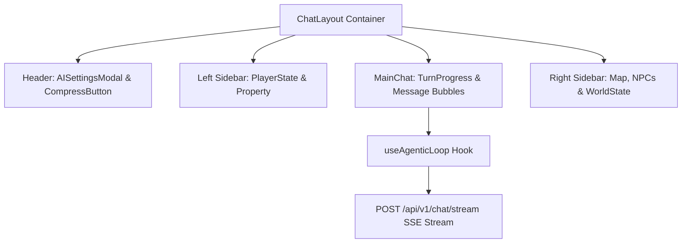

# Implementation Plan - F013: Інтерфейс Чату (UI Chat Interface)

Фіча F013 реалізує головне вікно гри — **Інтерфейс Чату** з дотриманням принципу **Narrative-First UI**. Чат є єдиною зоною взаємодії з грою. Він підключається до реального бекенд SSE-потоку Агентного циклу (F012), транслює оповідь Майстра у реальному часі, інтегрує кнопковий ігровий капелюх (Налаштування ШІ F020 + Завершення глави F012) та підтримує 3-колонковий адаптивний макет.

## User Review Required

> [!IMPORTANT]
> **Ключові функціональні рішення:**
> 1. **Інтеграція з F012 Agentic Loop (SSE Streaming):**
>    - Заміна старого mock-опитування на реальний потоковий вивід через `useAgenticLoop` та ендпоінт `POST /api/v1/chat/stream`.
> 2. **3-колонковий адаптивний макет (ChatLayout):**
>    - **Ліва панель (Left Sidebar):** Стан персонажа (HP, Мана), Майно та Рюкзак.
>    - **Центральна зона (Main Chat):** Історія ходів, анімований `TurnProgressIndicator` стадій роздумів Майстра, стрімінг оповіді та автоматична прокрутка (Auto-scroll).
>    - **Права панель (Right Sidebar):** Енциклопедія, мапа локацій, активні NPC та фракції.
>    - **Mobile:** Бічні панелі ховаються за гамбургер-кнопками ("☰ Герой", "Світ ☰") і відкриваються як Overlay.
> 3. **Дизайн повідомлень (ChatMessage Bubbles):**
>    - **Player Bubble:** По правому краю, яскравий акцентний фон.
>    - **Master Narrative:** По лівому краю, темна картка, Markdown-підсвічування тексту.
>    - **System Notification:** По центру (технічні події: з'єднання, стиснення історії).
> 4. **Зона Вводу (ChatInput):**
>    - Автоматичне розширення висоти `textarea` залежно від тексту.
>    - `Enter` — відправка запиту, `Shift + Enter` — новий рядок. Блокування під час генерації оповіді.
> 5. **Шапка Чату (Chat Header Controls):**
>    - Кнопка `⚙️ Налаштування ШІ` (відкриває модальне вікно F020 `AISettingsModal`).
>    - Кнопка `📜 Завершити главу` (викликає стиснення контексту 80/20 `CompressContextButton`).

---

## 1. Архітектурна схема компонента Чату

---

## Proposed Changes

### Frontend (`master_of_game_UI`)

#### [NEW] [ChatMessage.tsx](file:///d:/My/MasterOfGame/master_of_game_UI/src/features/chat/components/ChatMessage/ChatMessage.tsx) & `ChatMessage.module.css`
Компонент рендерингу повідомлення (Player / Master / System) з підтримкою Markdown та стилів розрізнення типів.

#### [NEW] [ChatInput.tsx](file:///d:/My/MasterOfGame/master_of_game_UI/src/features/chat/components/ChatInput/ChatInput.tsx) & `ChatInput.module.css`
Багаторядкова `textarea` з підтримкою гарячих клавіш (`Enter`/`Shift+Enter`), автоматичної зміни висоти та стану блокування `isProcessing`.

#### [MODIFY] [useChat.ts](file:///d:/My/MasterOfGame/master_of_game_UI/src/features/chat/hooks/useChat.ts)
Оновлення хука чату: інтеграція з `useAgenticLoop`, завантаження історії повідомлень з бекенду та координація SSE-потоку в реальному часі.

#### [MODIFY] [MainChat.tsx](file:///d:/My/MasterOfGame/master_of_game_UI/src/features/chat/components/MainChat/MainChat.tsx) & `MainChat.module.css`
Оновлення центральної зони чату: розміщення `WorldStateWidget`, списку повідомлень, індикатора `TurnProgressIndicator`, стрімінгового бабла та `ChatInput`.

#### [MODIFY] [ChatLayout.tsx](file:///d:/My/MasterOfGame/master_of_game_UI/src/features/chat/components/ChatLayout/ChatLayout.tsx) & `ChatLayout.module.css`
Оновлення 3-колонкового макета: інтеграція шапки з кнопками `⚙️ Налаштування ШІ` та `📜 Завершити главу`, висувних бічних панелей і мобільного Overlay.

#### [MODIFY] [uk.json](file:///d:/My/MasterOfGame/master_of_game_UI/src/i18n/locales/uk.json)
Оновлення локалізації секції `"chat"`.

---

## Verification Plan

### Automated Tests
- **Frontend Tests (Vitest)**:
  - `npx vitest run src/features/chat/hooks/useChat.test.ts`

### Manual Verification
1. Відкрити екран гри в браузері.
2. Перевірити роботу кнопок у шапці: `⚙️ Налаштування ШІ` (відкриває модалку) та `📜 Завершити главу` (викликає стиснення).
3. Ввести дію у чат і натиснути `Enter`.
4. Перевірити відображення бабла гравця по правому краю.
5. Спостерігати за анімованим статусом `TurnProgressIndicator` та стрімінгом відповіді Майстра.
6. Перевірити розгортання та згортання лівої та правої бічних панелей на Desktop та Mobile.
