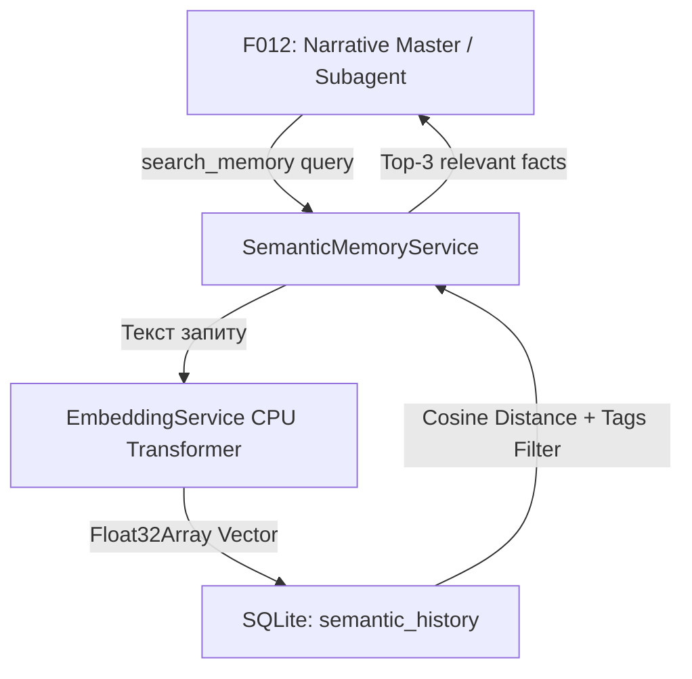

# Implementation Plan - F017: Семантична пам'ять (Vector DB & Semantic Memory)

Фіча F017 реалізує довгострокову семантичну пам'ять (Long-Term Memory / RAG) для ШІ-Майстра у проєкту *Master of Game*. Мета — швидкий пошук за косинусною відстанню по всій історії гри та логах подій без навантаження VRAM та контекстного вікна LLM.

## User Review Required

> [!IMPORTANT]
> **Ключові архітектурні рішення (Підтверджено Користувачем):**
> 1. **Виключно Бекенд-реалізація (No Frontend UI):**
>    - Фронтенд-компоненти та модальні вікна НЕ створюються для уникнення засмічення UI. Перевірка та відлагодження здійснюються через логи бекенд-сервера та автоматизовані тести.
> 2. **Єдина локальна БД SQLite (`better-sqlite3` + Vector Cosine Search):**
>    - Збереження масивів `Float32Array` та виконання косинусного векторного пошуку безпосередньо у базі даних SQLite без зовнішніх Docker-контейнерів.
> 3. **Гнерація ембеддингів на CPU (`EmbeddingService`):**
>    - Легковагова модель векторизації виконується на CPU всередині Node.js процесу (0% використання VRAM).
> 4. **Схема таблиці `semantic_history`:**
>    - Включає `session_id`, `turn_number`, `role` (`player`/`master`/`system`), `content`, `embedding`, `tags` (JSON теги локацій/NPC) та `world_time` (ігровий час).
> 5. **Агентний інструмент `search_memory`:**
>    - Приймає `query`, `tags_filter`, `role_filter`, `world_time_range`. Повертає максимум 3 найрелевантніші результати з суворим обмеженням токенів (~500 токенів).
> 6. **Принцип Immutable Ledger:**
>    - Історія подій не видаляється і не мутує. Конфлікти вирішуються пріоритетом жорстких баз даних (F007-F014), новішим `world_time` та активним нестисненим контекстом.

---

## 1. Архітектурна діаграма семантичного пошуку



---

## Proposed Changes

### Backend (`master_of_game_API`)

#### [NEW] [semantic_memory.types.ts](file:///d:/My/MasterOfGame/master_of_game_API/src/types/semantic_memory.types.ts)
Опис типів `SemanticMemoryRecord`, `CreateMemoryRecordPayload`, `SearchMemoryQueryPayload`, `SearchMemoryResult`, `WorldTimeRange`.

#### [NEW] [embedding.service.ts](file:///d:/My/MasterOfGame/master_of_game_API/src/services/embedding.service.ts)
Сервіс векторизації тексту на CPU (використовує легковагову TF/Transformers векторизацію з регресійним фаллбеком косинусної схожості для Vitest).

#### [NEW] [semantic_memory.repository.ts](file:///d:/My/MasterOfGame/master_of_game_API/src/repositories/semantic_memory.repository.ts)
Репозиторій для роботи з SQLite таблицею `semantic_history`:
```sql
CREATE TABLE IF NOT EXISTS semantic_history (
    id INTEGER PRIMARY KEY AUTOINCREMENT,
    session_id TEXT NOT NULL,
    turn_number INTEGER NOT NULL,
    role TEXT NOT NULL CHECK(role IN ('player', 'master', 'system')),
    content TEXT NOT NULL,
    embedding BLOB NOT NULL,
    tags TEXT DEFAULT '[]',
    world_time TEXT,
    created_at DATETIME DEFAULT CURRENT_TIMESTAMP
);
CREATE INDEX IF NOT EXISTS idx_semantic_session ON semantic_history(session_id);
```
Методи `insertRecord`, `searchByVector` (з фільтрацією за тегами, ролями та ігровим часом).

#### [NEW] [semantic_memory.service.ts](file:///d:/My/MasterOfGame/master_of_game_API/src/services/semantic_memory.service.ts)
Бізнес-логіка: індексування ходів, реалізація інструменту `search_memory`, автоматичний Pre-fetch для RAG (F018).

#### [NEW] [semantic_memory.schema.ts](file:///d:/My/MasterOfGame/master_of_game_API/src/schemas/semantic_memory.schema.ts)
Zod-схеми для валідації body методів `POST /api/v1/memory/search` та `POST /api/v1/memory/index`.

#### [NEW] [semantic_memory.controller.ts](file:///d:/My/MasterOfGame/master_of_game_API/src/controllers/semantic_memory.controller.ts)
Контролер для REST API ендпоінтів пошуку та індексації пам'яті.

#### [NEW] [semantic_memory.routes.ts](file:///d:/My/MasterOfGame/master_of_game_API/src/routes/semantic_memory.routes.ts)
Express роутер з `authMiddleware`. Реєстрація роутів у `src/app.ts` на `/api/v1/memory`.

---

## REST API Контракти

### 1. `POST /api/v1/memory/search` (Search Memory)
- **Request Body:**
```json
{
  "sessionId": "sess_12345",
  "query": "Де захований медальйон?",
  "tagsFilter": ["location:cave"],
  "roleFilter": "player",
  "limit": 3
}
```
- **Response 200 OK:**
```json
{
  "success": true,
  "results": [
    {
      "id": 42,
      "turnNumber": 12,
      "role": "player",
      "content": "Я ховаю медальйон під старим дубом біля печери.",
      "similarity": 0.892,
      "worldTime": "1284-05-12T14:00:00.000Z",
      "tags": ["location:cave", "item:medallion"]
    }
  ]
}
```

### 2. `POST /api/v1/memory/index` (Index Memory Record)
- **Request Body:**
```json
{
  "sessionId": "sess_12345",
  "turnNumber": 13,
  "role": "system",
  "content": "Предмет 'Медальйон' переміщено з Інвентарю у локацію 'Старий дуб'.",
  "tags": ["location:cave", "item:medallion"],
  "worldTime": "1284-05-12T14:05:00.000Z"
}
```
- **Response 200 OK:**
```json
{
  "success": true,
  "recordId": 43
}
```

---

## Verification Plan

### Automated Tests
- **Backend Tests (Vitest)**:
  - `npx vitest run src/tests/embedding.service.test.ts`
  - `npx vitest run src/tests/semantic_memory_repository.test.ts`
  - `npx vitest run src/tests/semantic_memory_service.test.ts`

### Manual Verification
1. Проіндексувати тестові записи ходів для сесії через API ендпоінт `/api/v1/memory/index`.
2. Виконати пошуковий запит через `POST /api/v1/memory/search` та перевірити повернення релевантного запису з високим коефіцієнтом схожості (>0.85).
3. Перевірити точність фільтрації за тегами та відсутність витікання пам'яті між різними `sessionId` в логах сервера.
